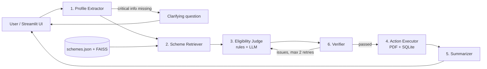

# 🧭 Scheme Navigator

**A multi-agent system that tells Indian citizens which government welfare schemes they qualify for, why, and how to apply.**

The user describes their situation in plain language (English, Hindi or Gujarati). The system returns the schemes they're eligible for with reasons, the schemes they *might* qualify for and what's missing, and a downloadable PDF checklist of documents and application steps.

> ⚠️ Guidance only, not an official eligibility decision. Scheme rules change; always confirm on the official portal linked for each scheme.

---

## Why

India has hundreds of central and state welfare schemes. Their rules are scattered across portals and PDFs and written in bureaucratic language, so many eligible people never apply. Helpers such as CSC operators and NGO volunteers face the same problem at scale.

## Architecture



A **hybrid** LangGraph design: a mostly linear pipeline over a shared typed state (`state.py`, the "blackboard"), plus two loops: a **clarification loop** (asks instead of guessing) and a **verifier retry loop**.

| # | Agent | Step | Input → Output |
|---|---|---|---|
| 1 | Profile Extractor | Understand | free text → `CitizenProfile` |
| 2 | Scheme Retriever | Retrieve | profile → candidate `SchemeDoc`s (state filter + FAISS ranking) |
| 3 | Eligibility Judge | Decide | profile + candidates → `EligibilityResult` per scheme |
| 4 | Action Executor | Execute | eligible results → PDF checklist, SQLite case record |
| 5 | Summarizer | Summarize | results → friendly reply in the user's language |
| 6 | Verifier | Evaluate | results → pass, or feedback to the Judge |

### Key design decision: rules for numbers, LLM for judgement

Age, income, land size, state and category checks run as **plain Python** (`rules/criteria_check.py`). The LLM only judges conditions a rule can't express, such as "not a practising professional" or "loan need is at least ₹10 lakh". The LLM may downgrade a rule-based "eligible", but the Verifier rejects any attempt to upgrade a rule failure. This keeps hallucinated eligibility at zero by construction.

## Knowledge base

`data/schemes.json`: **42 schemes** (31 central, 11 Gujarat) across agriculture, pensions and social security, education, women and child, health, livelihood, and housing. Each record has machine-checkable `criteria`, free-text `fuzzy_conditions`, documents, application steps, source URLs and a `last_verified` date. All entries were researched in November 2026 from official portals (myScheme, ministry sites, PIB, bank and state pages) and reputable secondary sources. Conflicts between sources are recorded in `notes`.

`data/personas.json`: **30 hand-labelled test personas** covering farmers, widows, students, artisans, street vendors, pregnant women, disabled people, TB patients and elders, in English, Hinglish, Hindi and Gujarati, plus negative tests (a tax-paying doctor who owns farmland) and a vague input that should trigger a clarifying question.

## Setup

```bash
git clone <your-repo-url> && cd scheme-navigator
python -m venv .venv && source .venv/bin/activate    # Windows: .venv\Scripts\activate
pip install -r requirements.txt
cp .env.example .env        # add GOOGLE_API_KEY (or OPENAI_API_KEY)
python -m scripts.build_index   # optional: builds data/faiss_index
streamlit run app.py
```

Command line: `python graph.py "I am a 45 year old farmer in Gujarat with 2 acres, income 1.2 lakh"`

## Evaluation

```bash
pytest -q                               # rule + graph tests (no API key needed)
python -m eval.run_eval --mode offline  # rule-only baseline from labelled profiles
python -m eval.run_eval --mode full     # full pipeline from raw text (needs API key)
```

| Mode | Precision | Recall | F1 | Hallucinated | Clarification |
|---|---|---|---|---|---|
| Offline (rules only, gold profiles) | 0.986 | 1.000 | 0.993 | 0 | 1/1 |
| Full (LLM) | _run and fill in_ | | | | |

The two offline false positives are deliberate traps that need judgement: Kisan Sahay without crop damage (P01) and Stand-Up India (minimum ₹10 lakh loan) for a small home tailoring shop (P30). The LLM judge should remove them.

## Project structure

```
├── app.py                  Streamlit UI with agent trace
├── graph.py                LangGraph wiring
├── state.py / schemas.py   shared state and Pydantic contracts
├── config.py / llm.py      settings, LLM + embedding factory
├── knowledge_base.py       loads schemes.json
├── agents/                 one file per agent
├── rules/criteria_check.py deterministic eligibility engine
├── prompts/                one prompt per LLM agent
├── data/                   schemes.json, personas.json
├── scripts/build_index.py  FAISS index builder
├── eval/run_eval.py        metrics on personas
└── tests/                  pytest, incl. a fake-LLM end-to-end test
```

## Responsible AI

- No real personal data; evaluation uses fictional personas. Case records stay local.
- Every recommendation links to the official source, and every reason is grounded in scheme text (checked by the Verifier).
- Conservative by design: unknown facts yield "needs info", not "eligible".
- Known risks: misreading informal descriptions of income or occupation; outdated rules. Mitigated by the clarification loop, `last_verified` dates and source links.

## Roadmap / TODO

- [ ] Run full-mode evaluation and fill in the table
- [ ] Few-shot examples in `prompts/profile_extractor.md`
- [ ] LLM tone/readability check in the Verifier
- [ ] Unicode font in the PDF for Gujarati/Hindi output
- [ ] Replace the clarification END/restart with LangGraph `interrupt()` + checkpointer
- [ ] Add more states' schemes
